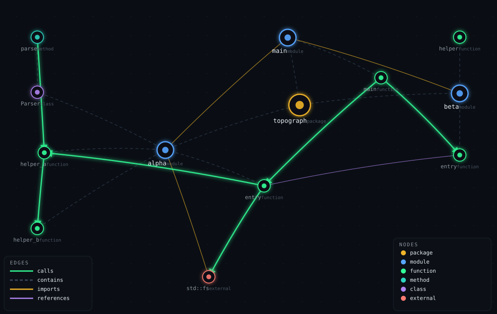

# codetopo

Registry identity: mcp-name: io.github.nrupala/codetopo

**See your codebase the way an agent sees it.** codetopo turns a source
repository into a queryable code graph — symbols, calls, references, and
structure — with JSON answers an AI coding agent can act on directly.

[](https://www.bestpractices.dev/projects/15421)
[](https://scorecard.dev/viewer/?uri=github.com/nrupala/codetopo)

codetopo holds the [OpenSSF Best Practices Passing badge](https://www.bestpractices.dev/en/projects/15421) — 100% of 67 criteria.

You are here because an agent just touched your codebase and you want to
answer structural questions fast: *what calls this function? what breaks if
I change this? how are these two modules connected?* codetopo indexes the
tree once and answers those questions as data — counts first, full lists
only when asked — over a CLI, an HTTP API, or the MCP tools your agent
already speaks.

It is deliberately domain-blind: it reports measurements — counts and
rankings of structural facts, each with its method stated — and it never
scores code quality or holds opinions about what the code means. It answers
structural questions about source trees, and only that. Domain meaning
belongs to the agents and teams composing on top.

codetopo is a product of **AIMLDS** (2351485 ALBERTA INC.) — the house
behind [Conduit](https://pipavia.com), managed MCP connector rails where
every call is routed, metered, and receipted.



**Live demo:** [codetopo.aimlds.org](https://codetopo.aimlds.org) — codetopo's real map of this repository, drawn by codetopo itself and refreshed on every push to `main`.

## 60-second quickstart

Requires a stable Rust toolchain (install via [rustup](https://rustup.rs)).

```sh
# Install the four binaries: codetopo (CLI), codetopo-server (HTTP API),
# codetopo-mcp (stdio MCP server), codetopo-acp (stdio ACP agent).
# The packages must be named — a bare install URL fails because the
# repository contains multiple binary packages.
cargo install --git https://github.com/nrupala/codetopo codetopo-cli codetopo-server codetopo-mcp codetopo-acp

# Index a repository (Rust and TypeScript/JavaScript are parsed via tree-sitter)
codetopo index ~/my-project --db graph.db

# Find a symbol's id by name (every surface has this discovery step)
codetopo search connect --db graph.db

# Ask what calls what (the package prefix is your directory's name,
# exactly as indexed — hyphen included)
codetopo descendants my-project::net::Client::connect --db graph.db --expand
```

That's the whole loop: **index once, query as data.** Aggregate-first
output — totals before lists — keeps token budgets and pipes sane by
default; `--expand` brings the full list when you want it.

## Example queries

Against the fixture repository used in the project's own end-to-end
verification (`docs/phase-2-verification.md`) — output shown is the real
output of the CLI:

```sh
$ codetopo index crates/codetopo-server/tests/fixture-repo --db graph.db
files indexed: 3
files failed: 0
symbols: 6
nodes: 15
edges: 23
diagnostics: 2

$ codetopo stats --db graph.db
nodes: 15
  package: 1
  module: 3
  file: 3
  function: 6
  external: 2
edges: 23
  calls: 5
  contains: 12
  reads: 6

$ codetopo descendants fixture-repo::alpha::entry --db graph.db --expand
2 descendants of fixture-repo::alpha::entry
fixture-repo::alpha::helper_a
fixture-repo::alpha::helper_b
```

A few more things you can ask (same engine, same data):

```sh
codetopo ancestors <node-id> --db graph.db     # what depends on this node
codetopo blast-radius <node-id> --db graph.db  # what a failure here would take with it
codetopo path <from-id> <to-id> --db graph.db  # shortest typed path between two nodes
codetopo verify --db graph.db                  # verify the hash-chained audit log
codetopo snapshot --db graph.db --out g.json   # portable frozen JSON export of the whole graph
codetopo restore --snapshot g.json --db g2.db  # restore a snapshot into a fresh database
```

The `path` answer renders as typed steps, e.g. `a --calls--> x --imports--> b`
(illustrative; exact ids depend on your index).

## Giving it to your agent

### HTTP API (`codetopo-server`)

The same queries over JSON, behind Bearer API-key auth, with per-request
metering — one transport for any client, any language:

```sh
KEY="demo-key:$(openssl rand -hex 16)"   # a fresh random secret, generated exactly as docker-compose does — never a published example value
echo "$KEY" > api_keys && chmod 600 api_keys
codetopo-server   # listens on 127.0.0.1:8080 by default

curl -H "Authorization: Bearer $KEY" -X POST localhost:8080/v1/index \
  -H 'Content-Type: application/json' -d '{"repo_path": "~/my-project"}'
# {"index_id": "<uuid>", "files_indexed": 3, "files_failed": 0, "nodes": 15, "edges": 23, "diagnostics": 2}

curl -H "Authorization: Bearer $KEY" \
  "localhost:8080/v1/graphs/<uuid>/descendants?node=<node-id>&expand=true"
```

Fifteen endpoints under `/v1`, one index operation plus fourteen read-only
queries: `POST /v1/index`, `GET /v1/graphs/{id}/{descendants, ancestors,
blast-radius, path, stats, verify, snapshot, neighborhood, symbol,
search, diagnostics, rank, diff}`, `GET /v1/schema`. Full contract in
[`schemas/openapi.yaml`](schemas/openapi.yaml) (OpenAPI 3.1.0), env knobs
(`CODETOPO_BIND`, `CODETOPO_DATA_DIR`, `CODETOPO_KEYS_FILE`,
`CODETOPO_METERING_LOG`) documented in [`schemas/README.md`](schemas/README.md).

### MCP (`codetopo-mcp`)

A stdio JSON-RPC server exposing the same handler layer as fifteen tools —
the eleven query/integrity tools (`codetopo_index`, `codetopo_descendants`,
`codetopo_ancestors`, `codetopo_blast_radius`, `codetopo_path`,
`codetopo_stats`, `codetopo_verify`, `codetopo_snapshot`,
`codetopo_diagnostics`, `codetopo_rank`, `codetopo_diff`) plus discovery
(`codetopo_search_symbols`, `codetopo_get_symbol`,
`codetopo_neighborhood`, `codetopo_describe_schema`) — so an in-process
agent learns one surface and gets both. MCP answers are identical to the HTTP answers by
construction: both call the same `codetopo-core` queries.

```json
{ "mcpServers": { "codetopo": { "command": "codetopo-mcp" } } }
```

### ACP (`codetopo-acp`)

A stdio agent speaking the Agent Client Protocol — for editors and clients
that converse with agents instead of calling tools. Open a session on a
working directory and ask code-structure questions in plain language:

```
→ {"jsonrpc":"2.0","id":1,"method":"initialize","params":{}}
← {"jsonrpc":"2.0","id":1,"result":{"agent":"codetopo","protocolVersion":"1.0",
    "agentCapabilities":{"read_only":true,"code_structure":true},"agentInfo":{"name":"codetopo"}}}
→ {"jsonrpc":"2.0","id":2,"method":"session/new","params":{"cwd":"/path/to/repo"}}
→ {"jsonrpc":"2.0","id":3,"method":"session/prompt",
    "params":{"sessionId":"<id>","prompt":"blast radius of auth::login"}}
← {"jsonrpc":"2.0","id":3,"result":{"answer":"Blast radius of 'auth::login': 14 nodes — …"}}
```

Deterministic intent routing (descendants / ancestors / blast-radius / path /
stats / snapshot / verify) straight to the same `codetopo-core` queries —
no LLM, no network, no file writes. Edit requests get an honest read-only
refusal. stdout carries only protocol frames; diagnostics go to stderr.

## Hosted API (`codetopo` Hosted)

The same HTTP API, run by us, always on. We host the index; you send a
repository (public git URL or archive upload) and query the graph from
anywhere with your key — no local install, no server to run.

**US$19/month per key.**

| Included | |
|---|---|
| Active indexes | 25 |
| Queries | 10,000 / month |
| Repository size | up to 50,000 files per index |

How it works:

1. [Subscribe](https://buy.stripe.com/cNi00j0hYbEIbT9bz89Zm02) — checkout is handled by Stripe.
2. After payment you land on a claim page. Claim your API key there —
   it is shown exactly once, so save it when it appears.
3. Call the API at `https://codetopo-api.aimlds.org` with
   `Authorization: Bearer <key_id>:<secret>`, the same contract as the
   self-hosted server (see `schemas/`).

Cancel any time from the Stripe receipt link; the key stays active
until the end of the paid period and is then revoked.

This is the hosted form of the same product. The local CLI, MCP server,
and ACP agent in this repository stay free and open source (AGPL-3.0)
and are unchanged — the hosted tier is for when you want the graph
served, not installed.

## Architecture

```
        ┌─────────────┐   tree-sitter    ┌──────────────┐
        │ source tree │ ───────────────► │ codetopo-    │   extract symbols,
        └─────────────┘   Rust, TS/JS     │ extract      │   calls, references
                                          └──────┬───────┘
                                                 ▼
                                          ┌──────────────┐
                                          │ codetopo-core│   graph model:
                                          │              │   nodes, edges,
                                          │              │   traversal queries
                                          └──────┬───────┘
                                                 ▼
                                          ┌──────────────┐
                                          │ codetopo-    │   SQLite store +
                                          │ store        │   hash-chained
                                          │              │   audit log
                                          └──────┬───────┘
                                                 │
              ┌──────────────────────────────────┼─────────────────────────────┐
              ▼                                  ▼                             ▼                              ▼
       ┌──────────────┐                  ┌──────────────┐               ┌──────────────┐              ┌──────────────┐
       │ codetopo     │                  │ codetopo-    │ Bearer auth  │ codetopo-    │ stdio        │ codetopo-    │ stdio
       │ (CLI)        │                  │ server       │ JSONL        │ mcp          │ JSON-RPC     │ acp          │ ACP
       └──────────────┘                  └──────────────┘  metering    └──────────────┘              └──────────────┘
```

| Crate | Role |
|---|---|
| `codetopo-core` | Graph model, node/edge kinds, all traversal queries, snapshots |
| `codetopo-extract` | tree-sitter extractors (Rust, TypeScript/JavaScript) |
| `codetopo-store` | SQLite persistence + tamper-evident, hash-chained audit log |
| `codetopo-cli` | `codetopo` headless CLI — the reference query surface |
| `codetopo-server` | `codetopo-server` axum HTTP API (thin adapter over core) |
| `codetopo-mcp` | `codetopo-mcp` stdio MCP server (thin adapter over core) |
| `codetopo-acp` | `codetopo-acp` stdio ACP agent — conversational sessions over the Agent Client Protocol (thin adapter over core) |

The CLI, HTTP, MCP, and ACP surfaces are all thin adapters over the same
handlers — they cannot disagree. `schemas/` keeps the machine-readable
contracts (OpenAPI 3.1, MCP tool catalogue) checked against the running
servers. The store's audit log follows the trust-primitive pattern used
across this product line: a hash-chained, append-only record, verified by
`codetopo verify` / `GET …/verify`.

## Docs

- [Development log](https://codetopo.aimlds.org/log/) — how codetopo got here and where it is going, in plain words (kept with the releases; also linked from the demo site)
- [`docs/render.md`](docs/render.md) — deterministic render: the frozen layout spec (JSON) + SVG rules behind `codetopo render`
- [`docs/protocol-proof.md`](docs/protocol-proof.md) — MCP/ACP conformance evidence: strict stdio clients + official-schema validation
- [`docs/scale-gate.md`](docs/scale-gate.md) — the 10,000-file scale gate and its measured record
- [`Dockerfile`](Dockerfile) + [`docker-compose.yml`](docker-compose.yml) — self-hosted container: the HTTP API over your own indexes
- [`docs/phase-2-design.md`](docs/phase-2-design.md) — API design: endpoints, auth, metering, aggregate-first discipline
- [`docs/phase-2-verification.md`](docs/phase-2-verification.md) — end-to-end verification report (fixture numbers above come from here)
- [`docs/phase-3-acp-design.md`](docs/phase-3-acp-design.md) — ACP agent design: wire protocol, intent routing, read-only guarantee
- [`docs/phase-3-acp-verification.md`](docs/phase-3-acp-verification.md) — ACP verification report
- [`docs/quickstart-verification.md`](docs/quickstart-verification.md) — clean-machine verification of the quickstart and example queries above
- [`schemas/README.md`](schemas/README.md) — the two agent-facing contracts and where the spec departs from the design doc
- [`CODE_SCHEMA.md`](CODE_SCHEMA.md) — the graph schema (§6 sets the aggregate-first rule)

## Privacy Policy

codetopo runs entirely on your machine. The MCP server (`codetopo-mcp`), the CLI, and the index databases they create never send your code, your queries, or any usage data anywhere: there are no accounts, no API keys, no telemetry, and no network calls at runtime. Indexing reads only the repositories you point it at and writes only the database paths you give it. To delete your data, delete the index database files (the `.db` files, or the HTTP server's data directory) — nothing is held on any server, so there is nothing elsewhere to erase. To take your data with you, export it with the `snapshot` command, which writes the whole graph as one portable JSON file. Questions about privacy: info@aimlds.org.

## License

- Engine (`codetopo-*` crates): **AGPL-3.0-or-later** (see `LICENSES/`)
- Agent-facing contracts (`schemas/`: OpenAPI 3.1 spec, MCP tool catalogue): **Apache-2.0** (see `schemas/LICENSE-APACHE`)

Owned by [Nrupal Akolkar](https://nrupalakolkar.com) · Built with [Muse by Meta](https://muse.ai/join) — join Muse, then redeem code **101EEK** in Settings within 48 hours of joining and we both earn tokens.
